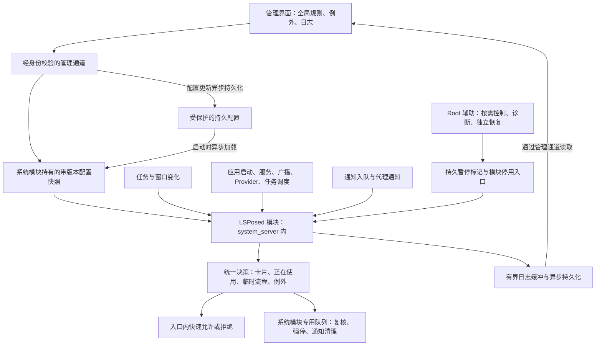

# Stop Card：按最近任务卡片管理后台

设计草案 v0.2 · 首个适配范围：Android 17 的指定测试构建

本版交付约定：卡片监听和系统原生强停构成核心；通知、各类后台入口、额外保活独立生效或降级，恢复心跳与可选监听器不作为核心门禁。强停在模块工作线程轻量复核后直接调用系统接口。跨应用保护保留可见窗口、Activity／Service 生命周期和隐藏后 30 秒兜底；不手动包系统锁，不反射追踪 ClientTransaction 或应用结果回调完成。下文精确回调验收项留待设备阶段评估，不作为本版已实现能力。

**路线已确定：基于 Stop，改为 Root＋LSPosed 模块。** 保留应用列表、设置和日志等基础，把后台管理核心改成“有卡允许运行，最后一张卡移除后停止”。Shizuku 不作为依赖。

日常管控由 LSPosed 系统模块完成，Root 用于按需辅助和独立恢复。有效卡片保留就允许后台；最后一张卡消失后，确认没有正在使用、支付回调或例外等保护，再经短复核强停。开机先观察并同步状态，不因只有历史卡片而批量强停。

这是待实现的设计，不是已经具备这些功能的安装包。文中“默认建议”和“待验证”不代表用户已经逐项确认。

## 1. 用户能感受到什么

| 使用场景 | 预期行为 |
|---|---|
| 打开一个普通应用，随后回桌面，卡片还在 | 继续允许它运行、联网和通知，不按一分钟倒计时杀掉 |
| 划掉这个应用的最后一张卡片 | 无其他保护时，经短复核强行停止整个应用，清掉它的普通通知，后续后台唤醒也受拦截；支付等流程保护至必要工作结束 |
| 同一个应用开了多张卡片 | 最后一张移除才停止 |
| 点击桌面图标重新打开 | 正常启动，重新获得运行许可，不需要“解冻” |
| 购物应用拉起支付、登录验证、相机或文件选择 | 保护这次操作及回传结果，不能中途误杀参与应用 |
| 应用偷偷唤醒另一个没有卡片的应用 | 在已覆盖的系统入口阻止；不因发起者有卡片就一律放行 |
| 新安装应用 | 自动按全局规则管理，不要求逐个勾选 |
| 电话、闹钟、桌面、输入法、Play 服务等必要组件 | 默认放开，并说明放开的原因 |

“有卡保活”分为两层：首先保证本工具不杀；再尽量降低系统把它当作普通缓存进程回收的概率。**不能承诺内存耗尽、应用崩溃或系统重启后进程仍然活着。** 不自动反复重启已崩溃的应用。

全局规则适用于普通应用。没有卡片的普通应用默认不获得长期后台许可；系统必要服务和用户明确放行的服务属于例外。

## 2. 默认规则与尚可调整的细节

### 2.1 已明确的要求

1. 划掉最后一张有效卡后，经短复核且无其他保护时停止；保留有效卡片时不因退到后台而停止。正在使用、临时操作和必要服务等保护按第 5 节统一判断。
2. 使用 Android 的强行停止机制，不采用停用、隐藏、暂停应用，也不将进程冻结作为执行方式。
3. 没有运行许可的应用不能继续发布通知。
4. 普通应用全局默认纳入，新装应用自动纳入。
5. 拦截后台互相唤醒；保留用户发起的支付、验证、分享等操作。
6. 必要系统组件默认放开。
7. 实现基于 LSPosed；Root 用于辅助控制、诊断和恢复。

### 2.2 本稿采用的默认建议

| 尚未逐项确认的细节 | 草案默认值 | 影响 |
|---|---|---|
| 音乐、导航、下载应用划卡 | 停止，与普通应用一致 | 想继续，就保留卡片或主动放行 |
| 按返回键退出 | 看真实任务变化：有效卡片仍在就保留；最后一张消失才撤销卡片许可 | 没有正在使用、临时流程或例外保护时，经短复核停止 |
| 手机重启后显示上次的历史卡片 | 不凭历史缩略图自动启动或放行，也不据此批量强停 | 用户重新打开后才计入本次有效卡片；状态就绪后限制已知无许可的后台请求 |
| 划卡后原有通知 | 清除该应用可清除的普通通知 | 系统电话、VPN 等必要提示受保护 |
| 微信、QQ、Telegram 等通讯应用 | 按卡片管理，不自动全部放行 | 划卡后不能保证收消息；保留卡片或加入例外 |
| 分屏、画中画 | 算正在使用 | 不能只看当前最顶层应用 |
| 划卡动作的执行时间 | 无其他保护时，约 0.3～1 秒内完成，属于目标而非实测值 | 留很短的复核窗口，避免刚划掉又打开时误杀；支付等流程另按结束条件复核 |

这里的短复核窗口只处理竞态，不是 Stop 原来的“离开前台后宽限一分钟”。

## 3. 上游基线与可复用部分

基线：[burakgon/stop](https://github.com/burakgon/stop)，版本 `v1.0.0`，固定提交：

```text
51c6b61c1988750821edeb36e05831726bcb1f24
```

基线使用 Kotlin、Compose、Room、DataStore、AIDL；`compileSdk=37`、`targetSdk=36`、`minSdk=28`。这只是上游配置，**不代表本改版从第一天就支持 Android 9～17**。首版只对指定 Android 17 测试构建验收。

| 上游文件或目录 | 改造方式 |
|---|---|
| `ui/apps/`、`data/InstalledApps.kt`、图标组件 | 复用应用列表，增加“有卡、临时放行、已停止、必要服务”等状态 |
| `data/RulesRepository.kt`、`data/db/StopDatabase.kt` | 复用存储基础，规则改成全局默认管理＋少量例外；增加数据库迁移 |
| `data/SystemRoles.kt`、`daemon/EssentialApps.kt` | 复用必要角色识别，补充当前 VPN、多用户和共享 UID 处理 |
| `data/EventsRepository.kt`、`ui/activity/` | 复用日志界面，记录为什么保留、停止或拦截 |
| `daemon/Enforcer.kt` | 替换核心决策；取消 `leftAt + graceMs` 驱动的后台停止逻辑 |
| `daemon/UidObserver.kt`、`ProcStateTable.kt` | 只作进程状态证据和核验，不再根据后台状态启动计时器 |
| `daemon/SystemApis.kt` | 复用有价值的封装；完整任务列表和 Android 17 接口需重新适配 |
| `core/DaemonClient.kt`、`daemon/StopDaemonService.kt` | 抽出传输层，改为管理界面与系统模块的受控通信；移除 Shizuku user service，不默认保留常驻 Root 管控服务 |
| `core/ConfigSync.kt`、`daemon/DaemonProtocol.kt` | 加入协议版本、配置代次、生效确认和能力报告；不能默认旧客户端可控制新模块 |
| `ui/onboarding/`、`ui/settings/`、`tile/` | 改成授权、框架状态、全局管理、暂停；删除一分钟宽限等旧选项 |
| `ShizukuCheck.kt`、`ShizukuMonitor.kt`、相关 Manifest/依赖 | 替换为 Root 和 LSPosed 就绪检测 |

上游的“划卡”判断主要借助进程退出记录，并非直接跟踪所有最近任务卡片；`SystemApis.topTask()` 也只看顶层任务。因此不能只把宽限时间改成零就当作完成。

上游许可证为 GPL-3.0。保留版权与许可证，发布改版 APK 时同时提供对应源码和构建说明。使用独立应用名、包名、签名及数据库，避免覆盖官方 Stop。当前包名为 `io.github.user4ooksk.stopcard`。

## 4. 确定的安装与运行架构

用户设备已具备 KernelSU。完整运行需要：Zygisk 实现 → 支持目标 Android 17 的 LSPosed 维护版 → 本项目模块 APK。

当前候选框架是 JingMatrix 的 **Vector**，它由 LSPosed 演进而来；Zygisk 候选为其官方文档推荐的 **NeoZygisk**。实际框架版本与目标系统的兼容结果须记录在测试材料中。

最终希望交付一个兼具管理界面和 Xposed 模块入口的 APK。必要的开机启动、恢复辅助文件可由 Root 配套安装；是否还需一个很小的 KernelSU 辅助模块，在恢复机制原型后确定。它不替代 LSPosed。

**默认不设置常驻 Root 管控服务。** 任务跟踪、规则判断、强停和通知清理由 `system_server` 内的模块承担；Root 仅在安装、按需配置辅助、诊断及独立恢复时使用。减少跨进程中转是架构选择，耗电和稳定性收益需实测。



### 4.1 各部分负责什么

| 部分 | 职责 |
|---|---|
| 管理界面 | 用户设置、状态和原因展示，不承担持续盯后台的工作 |
| 纯 Kotlin 规则核心 | 输入事实，输出决策；不直接操作 Android，方便测试 |
| LSPosed 系统模块 | 获取真实任务变化，持有可信配置；入口快速判断，专用队列复核并调用系统强停／通知接口，异步持久化配置与日志 |
| Root 辅助工具／恢复脚本 | 按需安装、配置辅助和诊断，提供独立暂停与故障恢复；不参与每次后台决策 |
| Android 17 适配层 | 集中处理目标 ROM 的内部接口差异，报告哪些入口实际可用 |

首选仅作用于 `android` / `system_server`。只有实测无法可靠区分桌面划卡与系统任务变更时，才考虑增加 Pixel 桌面的窄范围适配；不能把“全部应用勾选作用域”作为默认安装方式。

### 4.2 系统里执行的代码必须轻

启动、广播和通知路径里只读内存快照，做有界判断。禁止在持有系统锁时运行 shell、访问网络、查数据库、等待外部进程回复或直接调用可能重入系统的强停操作。

任务事件更新策略状态。停止与通知清理提交到模块专用串行工作队列，复核后通过 Android 17 适配层调用系统接口；具体方法、调用身份和锁顺序必须在目标 ROM 验证。日志采用有界缓冲并异步落盘，不能阻塞停止和暂停操作。

管理界面断连时，已有可信配置和任务状态可继续生效；界面不能把未确认的修改显示成已生效。配置不完整、关键任务状态丢失或 ROM 方法不匹配时，暂停依赖该状态或接口的控制并明确显示“部分功能未启用”，不能把读不到任务列表解释为所有应用都没卡。

管理通道及 Root 辅助入口按权限校验调用 UID、应用签名、用户身份及协议版本；不暴露任意 shell 接口。应用自带的 Intent 参数不能成为放行凭证。

### 4.3 配置与独立恢复的边界

系统模块持有当前生效的配置快照。配置加载、校验与持久化在专用工作队列执行，通过后原子替换内存快照；启动入口不读文件。管理界面经受控通道提交设置，并显示系统模块确认的生效代次，重连时不以旧缓存覆盖新配置。

管理通道优先验证经鉴权的 Binder 方案；配置目录、文件权限、SELinux 可访问性和开机读取时机在阶段 0 核对，再固定实现。不能仅因代码运行于 `system_server`，就假定任意目录可读写或自定义服务可注册。首次启用前，通道与配置加载尚未通过验证时保持观察模式；启用后的界面断连按第 4.2 节处理。按需 Root 辅助不能绕过协议与配置校验。

独立暂停标记优先于普通配置，在挂接前和运行期间异步检查；检测到暂停后取消待执行停止。紧急命令需能核验暂停已生效，系统模块无法响应时转用独立停用入口。具体文件路径与命令按第 9 节实测后提供。

## 5. “卡片”如何变成运行许可

### 5.1 采用真实任务状态

在系统任务管理中维护最近任务清单和可见窗口状态，使用 `(userId, packageName)` 作为应用身份，使用 `(userId, taskId, bootEpoch)` 标识任务。

卡片存续以系统最近任务记录及其展示资格为依据，首选核对 `RecentTasks`；桌面动画、进程是否存在和某个 Activity 是否退出都不能单独决定卡片是否消失。按返回键、根界面返回和 `finish()` 的实际效果依应用与系统而异，统一按最终任务变化处理。

本次已激活且仍具备展示资格的任务计为有效卡片；带有 `excludeFromRecents` 等排除标记的任务不据此获得长期卡片许可，但可凭可见窗口或可信操作链获得保护。重启恢复的历史卡片按第 5.5 节处理，不能仅凭仍有缩略图计入本次有效卡片。

只计入用户实际打开或本项目确认的用户操作链创建的任务。后台应用不能通过伪造一张隐藏任务卡长期自我放行。首次启用时，已存在的任务只能作为来源未知的候选，先同步核对，不能因此批量误杀。

不能简单把一个 task 的 `baseActivity` 和 `topActivity` 当成所有参与应用：跨应用支付、浏览器验证以及文档任务可能共用任务，必须结合 Activity 记录、任务归属和临时操作链判断。

卡片代表运行许可，不等于进程一定存在。系统回收进程而保留卡片时，不会撤销许可，也不主动冷启动它。通知和后台工作是否可继续，取决于系统实际调度及应用自身实现。

### 5.2 状态表

| 状态 | 允许运行 | 通知 | 停止条件 |
|---|---|---|---|
| 必要服务／用户例外 | 是 | 遵守原系统通知设置 | 不由卡片规则停止 |
| 正在使用：前台、分屏、画中画 | 是 | 遵守原设置 | 退出使用且无卡、无有效临时流程 |
| 有本次有效卡片 | 是 | 遵守原设置 | 最后一张有效卡片移除，且无其他保护，经短复核停止 |
| 支付等临时流程 | 仅限已关联操作 | 按流程需要放行 | 结果完成、取消或经复核到期；有卡则转为有卡状态 |
| 无许可且状态已确认 | 否 | 在已启用入口阻止新通知，按规则清理普通通知 | 限制后台请求；发生许可撤销、用户关闭任务或确认无许可运行事件时，经复核异步强停；初始化不批量强停 |
| 状态未知／初始化中 | 暂缓干预 | 暂不新增拦截 | 恢复可信快照后再判定 |

判定优先级：全局暂停或状态未知 → 必要服务与例外 → 可见窗口 → 有效卡片 → 临时流程 → 无许可。

### 5.3 最后一张卡移除后的动作

1. 更新任务集合与策略代次，撤销卡片带来的普通后台许可，保留仍有效的可见窗口、临时流程和例外保护。
2. 安排一次短延迟核验，检查是否又被用户打开、是否还有另一张卡、是否正在使用、是否有待完成的支付回调或可信绑定、是否成为必要服务或用户例外。
3. 确认无其他保护后，由系统模块的专用工作队列强行停止该用户下的目标应用，协调处理它的普通通知。仍有临时流程时，待流程满足结束条件再复核。
4. 核验结果并记录“最后一张卡移除”；只在范围明确时处理关联的独立或隔离进程。

停止操作携带策略代次。新打开事件到来后，旧的停止任务自动失效。“先判断无卡、随后用户打开、最后旧任务把它杀掉”必须由测试覆盖。

系统修剪历史任务、任务迁移、显示器变化不等于用户明确划卡。先重新同步，按真实许可判断；日志区分“用户关闭”和“系统任务变化”。

看不到卡片只意味着不能再以卡片作为许可；仍在分屏、画中画或支付回调中的应用继续按对应理由保护。无卡界面的正常退出也走相同复核流程，不在窗口消失的一瞬间直接强停。

### 5.4 “有卡保活”的实际实现

第一层是硬性产品规则：本工具不再因后台时长或息屏停止有卡应用。

第二层是系统回收优先级的适度保护：仅对有许可且已经运行的进程，研究在目标 ROM 的进程优先级计算处调整缓存回收次序。不给普通应用系统级永久优先级，不修改 LMKD 的全局阈值，不无限增加后台进程上限。

这部分单独开关、单独验收；先测默认 Android 管理下的存活情况，再决定保护强度。内存紧张时允许系统回收，优先保证电话、桌面与系统服务。界面区分“允许后台”和“已启用额外保活”，不能把两者混为一个承诺。

Android 自身的 Doze、缓存冻结等机制与本工具的强停规则不同。首版不全局关闭它们；如果它们影响“有卡继续运行”的实际场景，后续只评估对持有许可应用的定向适配，并单独报告耗电变化。

### 5.5 开机与历史卡片：先同步，再按事件处理

历史卡片不能证明应用正在运行，也不能证明它没有运行。开机初期只观察，待用户、任务、配置、可见窗口及必要角色状态可信后，再启用对应入口的管控。

状态就绪后，历史卡片本身不提供运行许可；在已适配并启用的入口，限制已知无许可应用的后台启动、互相唤醒和通知。用户点击桌面图标或历史卡片时，按可信打开处理，随后确认实际任务状态。

**初始化不因缺少本次有效卡片而遍历所有应用执行强停。** 主动强停由最后一张有效卡片移除、用户划掉历史卡片、正在使用或临时流程结束等关闭或许可撤销事件触发；每次都复核其他卡片、可见窗口、回调和例外。初始化后，若运行事件或状态核验已确认某应用正在无许可运行，可针对该应用复核并强停；不以“仅有历史卡片”作为运行证据。

初始化过程中的许可变化要保留，状态同步完成后逐项复核，避免漏掉刚发生的关闭动作。任务来源或事件顺序无法确认时保持未知状态，恢复可信状态后再判定。

## 6. 拦互相唤醒，保留用户跳转

### 6.1 需要覆盖的入口

| 系统行为 | 设计处理 | 候选代码区域，具体签名待核对目标 ROM |
|---|---|---|
| 启动 Activity | 识别用户打开或可信操作链；后台自发启动不得自动取得许可 | `ActivityTaskManager`、Activity 启动流程 |
| 启动／绑定 Service | 无许可目标受限；已关联支付服务等只放行所需调用 | `ActiveServices` |
| 广播投递 | 按接收包许可判断，不让被系统转发的普通应用请求绕过 | 广播队列及投递逻辑 |
| 获取 ContentProvider | 区分系统公共 Provider、用户操作所需 Provider 与后台互拉 | Provider 获取流程 |
| Job、闹钟触发 | 注册行为与真正执行分开处理，在执行时复核 | JobScheduler、AlarmManager 分发路径 |
| PendingIntent | 关联创建者、实际发送者、目标与用途 | PendingIntent 发送流程 |
| 系统兜底拉进程 | 补查遗漏，不能仅靠 PID 出现后再杀 | 进程启动流程 |

这些是适配范围，不是已验证的完整覆盖表。目标已经运行时也要检查调用，不能只拦“创建新进程”。拒绝要符合各入口约定，保持 Binder 引用、广播完成及超时清理正确，不能用随便返回 `null` 的方式碰运气。

### 6.2 给用户操作发临时许可

典型流程：购物应用 A → 支付应用 B → 银行或认证组件 C → 返回 B → 返回 A。

系统中维护一次操作的身份、发起方、目标、相关 Activity/task、回调、用户与当前阶段。B 没有独立卡片时也能在本次支付中运行；完成后，没有卡片且没有其他理由就收回许可。

临时许可按关联目标与组件发放，不是“30 秒内任何应用都能启动”。多级跳转只沿实际交互链扩展，不能由一个已放行应用批量给其他应用授予后台许可。

允许以下较明确的用户来源：桌面点击、系统任务切换、通知点击、系统分享／文件选择器，以及已建立的交互流程。普通应用处于前台，只是一条证据，不能直接等于用户刚点了按钮；仅在后台留有卡片，也不能因此给其他无许可应用放行。

派生临时许可时，结合系统记录的调用身份、可见 Activity、目标组件、任务／结果关联以及已有操作链判断。`startActivity`、显式 Intent 或 `bindService` 本身都不是用户授权凭证。已建立流程中的可信回调、服务绑定和系统转发可以在发起方退到后台后继续，但只能沿已关联目标与用途放行。

**Android 没有一个对所有应用、所有 SDK 都准确的“这次启动来自真人点击”标志。** 对自定义支付 SDK、无界面的服务回调，必须做实际适配和受限临时许可；不能在设计书里承诺零误判。第一版先观察未知调用，记录候选理由，经过测试才启用对应入口的严格拦截。

超时使用单调时钟，先建议交互隐藏后 30 秒进入复核；超时不是直接杀支付进程。界面仍可见、回调未完成或存在可信绑定时继续保护；流程结束撤销，异常流程超过可配置上限则再次核验并写日志。具体时限由支付与认证测试调整。

### 6.3 支付返回后的收尾

从支付应用 B 返回购物应用 A，不等于 B 已经完成全部工作。需要确认结果已交付或流程已取消、必要回调及绑定已结束，并复核 B 是否还有有效卡片、可见窗口或例外；有其他许可时继续保留。

若 A、B 的 Activity 共用一个任务，还需核对 B 的相关 Activity 已完成正常退出、任务与回调状态一致，再安排短复核停止；不能把页面刚隐藏当作退出完成，也不能为停止 B 删除整个共享任务。该场景必须验证 A 的页面与结果不受影响，不能仅依据 B 的进程已结束判定成功。

## 7. 通知与必要服务

### 7.1 通知控制

在 NotificationManagerService 通知入队前判断目标包是否有许可，阻止已知无许可目标的新通知；不靠通知监听器“先出现再删除”。撤销许可时清理普通存量通知。

区分实际发起者与通知所属应用，覆盖 GMS／其他代理替应用发布通知的情况。GMS 自身放开，不等于它代发的所有普通应用通知也放开。对于确实归属 GMS 自身、无法可靠识别目标的系统通知，保留并记录能力限制，不能粗暴屏蔽全部 Play 服务通知。

只追加本工具的限制，不修改用户的通知总开关、渠道设置或系统授权。用户原本关掉的通知不会因为“有卡”被强行打开。必须核验拒绝前台服务通知的系统后果，避免制造服务崩溃或卡死；无许可应用的停止与通知清理要协调执行。

### 7.2 默认放开的范围

首版保守保留系统组件：电话与短信基础设施、桌面、输入法、系统设置、安装器、权限管理、网络／蓝牙／NFC、必要 Provider、WebView、Play 服务／服务框架／商店、Root 管理器和本工具。

动态保护用户正在依赖的角色：默认拨号／短信、实际使用的闹钟、当前 VPN、已启用的自动填充与无障碍服务、通知监听，以及实际添加的桌面小组件。小组件和活跃 VPN 只取主用户的系统记录。动态例外在界面逐项说明来源；角色存在时按应用保护，撤销后重新复核其他许可。

SystemUI 的快捷开关绑定和系统进程的 VPN 服务绑定，按真实调用身份、解析后的组件和原生绑定权限核验。只保护实际绑定及服务销毁过程；同包依赖按具体组件临时观察，隐藏后固定短超时，重复组件回调不延长该期限。普通后台 Job 与同步服务不据此放行。桌面快捷方式保留直接打开来源；桌面发送的 PendingIntent 以最终解析的目标组件为准临时观察，包括同包目标。

首版默认不对剩余系统预装包强推卡片限制。后续若用户要收紧，由可审阅的分类规则处理；不把所有系统包都宣称为必不可少。

普通应用即使有前台服务、播放音乐或正在下载，也不因此自动获得永久例外。是否允许划卡后继续，由用户例外决定。

同一 UID 的多个包、共享进程、隔离服务、工作资料与私密空间要单独处理：无法可靠隔离时保护整组并说明原因。不能为了停止一个普通包误伤共享系统 UID。首版只在主用户执行；其他用户空间明确显示“尚未启用”，不能误报已受管。

## 8. 配置、数据和界面

### 8.1 最小数据模型

| 对象 | 主要字段 |
|---|---|
| 应用身份 | 用户 ID、包名、安装代次、UID、签名摘要 |
| 应用例外 | 遵循全局／用户放行／必要角色；原因与来源 |
| 任务状态 | 用户、taskId、开机代次、归属与参与包、可见状态、用户来源证据 |
| 临时操作许可 | 操作 ID、来源／目标、组件类型、任务／回调关联、期限与结束原因 |
| 配置快照 | 协议版本、配置代次、已生效代次、全局开关、例外、适配能力 |
| 决策日志 | 时间、目标包、触发类型、原因、执行结果、适配版本 |

持久化用户设置与例外；有效卡片和临时许可按开机状态重建，不能把一次支付授权永久写进数据库。包卸载／重装、UID 复用、签名变化时旧许可作废；普通同签名升级保留用户例外并重新核验当前状态。

### 8.2 界面只留有用的东西

- 首页：管理已开启／已暂停／部分功能不可用，当前有卡、临时放行、已停止数量；醒目的暂停按钮。
- 应用页：默认全部普通应用受管，只需编辑例外；每个应用显示“为什么能运行”。
- 日志：例如“微信：最后一张卡被移除，已停止”“支付宝：正在支付，临时保留”“某应用尝试拉起另一应用：已拦截”。
- 设置：清除旧通知、重启历史卡片策略、有卡额外保活、诊断导出。
- 诊断页：框架版本、管理通道状态、配置生效代次、Root 辅助与恢复入口状态、各系统入口是否适配；正常首页不堆内部类名。

保留本地使用、不加统计和广告。默认日志只含包名、事件和原因，不保存支付参数、消息正文或完整 Intent extras；日志滚动保留 7 天并设置容量上限。

## 9. 出故障时如何停止干预

这部分应先于全面拦截实现，因为目标代码运行在 Android 核心进程内，系统卡死或循环重启时仍需独立停用路径。

1. **总开关**：快速撤销本工具的拦截和额外保活，取消尚未执行的强停；系统其余功能继续工作。
2. **观察模式**：只记“本来会怎么判”，不拒绝、不强停，首个原型默认使用它。
3. **功能级降级**：某入口签名或语义不匹配，只关闭这一组能力；关键任务状态丢失则暂停所有依赖它的停止决策。
4. **开机保护**：启动初期仅观察，拿到用户、任务、必要角色等完整状态后再按开关工作；历史卡片与初始化强停按第 5.5 节处理。
5. **循环失败保护**：由独立的 Root 恢复机制记录启动尝试和就绪结果；下一轮启动在挂接前检查暂停标记。阈值先拟定 5 分钟内 2 次异常，需验证时钟、写入时机，以及正常重启、整机异常重启和同次开机内 `system_server` 重启的区分。只执行一次的开机脚本不能视为已覆盖所有故障；是否需要最小监测辅助，在恢复原型中确定，其职责限于恢复。
6. **独立恢复入口**：即使管理界面打不开，也能通过 Root／具备所需权限的 ADB 禁用本项目，必要时禁用框架模块。恢复入口不依赖管理界面或日常配置通道存活。具体路径与命令在实现后生成并实测，不写未经验证的“万能救砖命令”。

暂停不意味着让所有被强停应用自动恢复运行、定时任务和推送。重新打开应用通常是恢复其正常调度的必要步骤；恢复说明必须写清楚。撤销额外保活只恢复本项目改动，不能批量重置用户设置。

异常捕获可防部分 Java 错误，无法保证避免 native 崩溃、系统死锁或框架故障。因此恢复方案本身也需要在可恢复测试环境验证，不能仅靠 `try/catch` 声称不会重启。

## 10. 分阶段开发与交付

| 阶段 | 交付 | 通过条件 |
|---|---|---|
| 0：框架与接口观察 | 固定框架版本、目标 ROM 构建、只读能力报告、管理通道与存储可行性核对、恢复原型 | 框架运行正常；确认完整任务变化、用户身份、必要角色及历史卡片识别；验证通信鉴权、存储权限和独立停用路径 |
| 1：基线与基础架构 | 独立包名、受控管理通道、LSPosed 入口、异步执行队列、纯规则核心、总开关和恢复入口 | 不再依赖 Shizuku；日常管控不依赖常驻 Root 服务；配置生效可确认，关闭管理无管控副作用，恢复路径可用 |
| 2：卡片管理 | 有卡不主动杀、最后卡移除复核强停、多卡／分屏／返回键／竞态处理、开机状态重建 | 卡片与开机验收通过；先小范围测试，操作链保护等必要用例通过后再扩大范围 |
| 3：通知控制 | 撤销许可后的通知入口限制与存量清理 | 普通／代理／前台服务通知用例通过 |
| 4：启动控制与交互保护 | 逐类入口覆盖、支付／验证流程许可、能力报告 | 对已覆盖入口实现事前拦截；用户操作场景正常 |
| 5：有卡额外保活与耐久验证 | 受控回收优先级、耗电与资源对比、恢复验证 | 保活改善有证据，系统前台体验不退化，无持续崩溃 |

前两阶段是开发里程碑，**不是把“划卡杀后台”当作完整四项需求的交付**。完整版还必须完成通知、互唤醒和操作链保护。

建议按上述边界拆提交：基线构建 → 独立身份与协议 → 总开关与独立恢复 → 纯规则引擎及测试 → 任务观察与开机同步 → 卡片执行 → 通知 → 各启动入口 → 操作链与收尾 → 保活 → 恢复耐久验证与文档。每步保留可回退版本。

不在尚未探明 Android 17 接口前承诺固定工期。最主要的不确定性是任务来源识别、支付服务回调及系统启动入口兼容，不是 Compose 界面。

## 11. 验收清单

先用可控的测试应用制造启动／广播／Provider／通知场景，再用真实日常应用验证；不用支付扣款作为测试要求，可停留在确认前或取消流程。

| 编号 | 场景 | 合格标准 |
|---|---|---|
| C1 | 应用退后台，卡片保留 30 分钟，包含息屏 | 本工具未停止它，无一分钟到期动作；系统回收需区分记录 |
| C2 | 无其他保护时划掉最后一张有效卡 | 经短复核在目标时间内完成强停，普通进程结束；非停用、非隐藏、非暂停 |
| C3 | 同应用两张文档卡，删其中一张 | 不强停；删最后一张才停止 |
| C4 | 划卡后立即重开，重复 100 次 | 旧决策不杀掉新会话 |
| C5 | 分屏／画中画／锁屏前台／快速切换 | 正在使用的应用不被误杀 |
| C6 | 返回键退出、`finish()`、主动移除任务、排除最近任务的界面 | 有效卡仍在就保留；无卡且无可见窗口、临时流程或例外时才复核停止；排除任务不取得长期卡片许可 |
| N1 | 无许可应用发普通通知 | 在入队前拒绝，无闪现；有许可后遵守原系统通知设置 |
| N2 | GMS／代理通知、前台服务通知 | 已知目标按许可处理，系统必要通知正常，无服务异常循环 |
| W1 | A 后台启动、绑定、广播唤醒无卡的 B | 每个已启用入口单独验证事前拦截，不能仅证明后来杀掉 B |
| W2 | B 已在运行，A 再调用 B；Provider／Job／闹钟／PendingIntent | 已覆盖路径仍正确判断，不因已有进程而绕过 |
| U1 | 购物→支付→认证→返回／取消，含跨包共用任务及延迟回调 | 回调与必要绑定结束前不误杀；收尾后无许可则停止，购物页面不受影响，不扩散为全局放行 |
| U2 | 系统分享、文件选择、相机、浏览器登录 | 目标和发起方按需保留，临时许可最终释放 |
| U3 | 前台应用无交互地拉起其他应用；可信操作链在发起方退后台后继续 | 不仅凭前台身份授予临时许可；按已验证入口处理未知调用；已关联的后台回调正常，无关目标不继承许可 |
| E1 | 电话、短信、闹钟、输入法、VPN、自动填充、无障碍 | 核心功能正常；例外来源可见 |
| E2 | 新装、更新、卸载重装、无桌面入口插件 | 默认管理一致，旧 UID／旧签名许可不泄漏；无法隔离情况可见 |
| R1 | 真正重启、历史卡片恢复、界面进程被杀及管理通道重连 | 开机先观察，不凭历史卡片放行或批量强停；就绪后已启用入口限制无许可请求；重开能激活卡片，界面断连不丢失可信配置 |
| R2 | 任务读取失败、接口不匹配、事件乱序 | 暂停相关控制并提示，不把未知当作空任务列表 |
| R3 | 强停前收到新的打开事件；启用总暂停 | 决策代次生效，待执行停止被取消 |
| R4 | 禁用模块、模拟故障恢复 | 能独立撤销本项目，不清用户数据，不无限重启 |
| R5 | 配置持久化／重载、无常驻 Root 管控服务、管理通道与系统模块异常 | 生效代次一致，未确认更新不误报成功；状态可信时日常管控独立工作，独立暂停和停用可核验 |
| R6 | 初始化时关闭任务、划掉历史卡、发现已运行的无许可应用 | 不遍历应用批量强停；事件保留并在状态可信后针对目标复核，不遗漏关闭，不误伤可见窗口、回调或例外 |
| P1 | 有卡应用的内存压力对照 | 记录保活改善及系统响应，不以永久占用内存换取表面存活 |
| P2 | 连续日常使用与待机对照 | 至少 24～48 小时观察无新增系统崩溃，记录 CPU、内存与耗电；不编造节电百分比 |

规则核心应使用假时钟测试事件顺序、许可过期和多任务计数；ROM 接口与拦截返回值必须通过实机／测试设备验证，不能由纯单元测试替代。

## 12. 当前结论、证据与实施边界

确定以 Stop 为基础是合理的：可省掉应用管理、设置、存储和日志的重复工作。需要重写的是决策核心，新增工作主要在 LSPosed 系统接口及交互流程保护。

原稿的源码核对记录：Stop v1.0.0 依赖 Shizuku；核心按离开前台后的宽限期强停；上游存在纯 Kotlin `Enforcer` 与单元测试；其必要角色识别可以复用。设备上已安装软件与框架状态在阶段 0 重新核对。

当前源码已包含统一许可核心、系统入口适配、管理通道、独立恢复辅助及可控测试应用。离线检查与设备验收分开记录：目标系统的挂接、通信权限、操作链、各入口拒绝语义、恢复与额外保活效果仍须按第 11 节逐项验证。设备步骤见 [设备验收](device-tests.md)，不能把源码存在或单元测试通过当作设备验收完成。

可复核来源：

- [Stop 固定源码基线](https://github.com/burakgon/stop/tree/51c6b61c1988750821edeb36e05831726bcb1f24)
- [Stop Enforcer](https://github.com/burakgon/stop/blob/51c6b61c1988750821edeb36e05831726bcb1f24/app/src/main/java/io/github/burakgon/stop/daemon/Enforcer.kt)
- [Stop SystemApis](https://github.com/burakgon/stop/blob/51c6b61c1988750821edeb36e05831726bcb1f24/app/src/main/java/io/github/burakgon/stop/daemon/SystemApis.kt)
- [Stop SystemRoles](https://github.com/burakgon/stop/blob/51c6b61c1988750821edeb36e05831726bcb1f24/app/src/main/java/io/github/burakgon/stop/data/SystemRoles.kt)
- [Stop LICENSE](https://github.com/burakgon/stop/blob/51c6b61c1988750821edeb36e05831726bcb1f24/LICENSE)
- [Vector 官方说明与安装要求](https://github.com/JingMatrix/Vector)
- [Vector v2.2 发布说明](https://github.com/JingMatrix/Vector/releases/tag/v2.2)
- [NeoZygisk v2.4 Android 17 支持说明](https://github.com/JingMatrix/NeoZygisk/releases/tag/v2.4)
- [KernelSU 模块指南](https://kernelsu.org/guide/module.html)

以上来源沿用原稿记载的 2026-11-04 核对结果，本稿修订未新增源码或实机验证；后续版本变化需重新验证。文中的系统内部类名是适配候选，尚未据此确定手机当前构建的方法签名。
